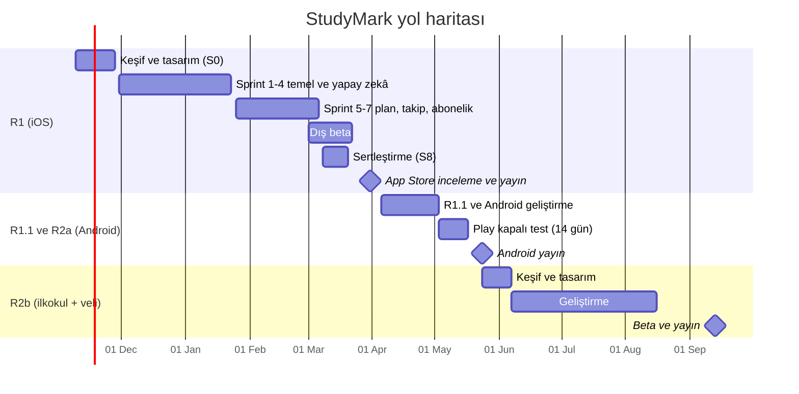
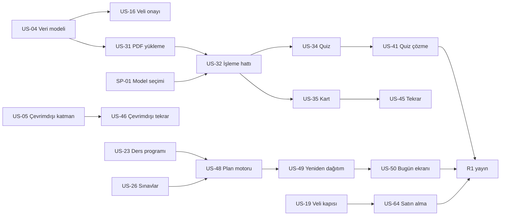
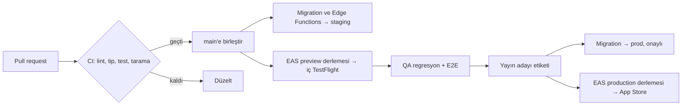

# StudyMark — Uçtan Uca Proje Planı

| Alan | Değer |
|---|---|
| Doküman | Proje planı (ekip, süreç, takvim, kalite, yayın, operasyon) |
| Sürüm | 0.1 (taslak) |
| Tarih | 3 Kasım 2026 |
| Hazırlayan | Tech Lead ve İş Analisti |
| Durum | İnceleme bekliyor |
| İlgili | [PLAN.md](../PLAN.md) · [01_brd.md](../analysis/01_brd.md) · [02_nfr.md](../analysis/02_nfr.md) · [backlog.md](backlog.md) |

---

## 1. Özet

StudyMark, 7 kişilik çekirdek bir ekiple 2 haftalık sprintlerle geliştirilecek. **R1 (iOS, ortaokul +
lise)** 31 Mart 2027'de App Store'da olacak. Böylece LGS ve YKS'ye yaklaşık 2,5 ay kala öğrencilerin
elinde olur. Android (R2a) Mayıs 2027 sonunda, ilkokul modu ve veli paneli (R2b) yeni eğitim yılının
başında, Eylül 2027'de çıkar.

### Kilometre taşları

| # | Kilometre taşı | Tarih | Çıkış ölçütü |
|---|---|---|---|
| M0 | Proje başlangıcı (kick-off) | 9 Kas 2026 | Ekip, araçlar ve erişimler hazır |
| M1 | Keşif ve tasarım tamam | 27 Kas 2026 | BRD v1.0 onaylı, ana akışların tıklanabilir prototipi, model değerlendirme ADR'si |
| M2 | Giriş ve veli onayı uçtan uca | 25 Ara 2026 | Öğrenci kayıt olur, veli e-postayla onaylar (staging) |
| M3 | Yapay zekâ çekirdeği | 22 Oca 2027 | PDF → özet/quiz/kart, quiz çözme (iç TestFlight) |
| M4 | Özellik tamam (feature complete) | 5 Mar 2027 | Tüm Must hikâyeler bitti; dış beta başladı |
| M5 | Yayın adayı (release candidate) | 19 Mar 2027 | Kritik/yüksek hata yok, mağaza materyalleri hazır, go/no-go kararı |
| M6 | **R1 yayında (iOS)** | **31 Mar 2027** | App Store onayı, kademeli yayın başladı |
| M7 | R1.1 + R2a Android yayında | 24 May 2027 | Play kapalı testi (14 gün) tamam; Kurban Bayramı sonrası yayın |
| M8 | R2b ilkokul + veli yayında | 13 Eyl 2027 | Okul açılışıyla birlikte |

## 2. Ekip ve roller

| Rol | Kişi | Zaman | Sorumluluk |
|---|---|---|---|
| Ürün sahibi (PO) | 1 | %50 | Vizyon, backlog önceliği, kapsam ve fiyat kararları, paydaş yönetimi |
| İş analisti (BA) | 1 | %100 | Gereksinimler, kabul kriterleri, süreç ve veri analizi, UAT koordinasyonu, dokümantasyon |
| Tech lead / kıdemli mobil geliştirici | 1 | %100 (≈%50 geliştirme) | Mimari, kod incelemesi, CI/CD, güvenlik, teknik kararlar (ADR) |
| Mobil geliştirici (React Native) | 1 | %100 | Ekranlar, çevrimdışı katman, bildirim, satın alma |
| Backend geliştirici | 1 | %100 | Supabase şeması, RLS, Edge Functions, yapay zekâ hattı, plan motoru |
| UX/UI tasarımcı | 1 | S0–S3 %100, sonra %50 | Araştırma, akışlar, prototip, tasarım sistemi, kullanılabilirlik testleri |
| QA mühendisi | 1 | S2'den itibaren %100 | Test stratejisi, otomasyon (E2E), regresyon, beta koordinasyonu |
| Eğitim danışmanı (öğretmen/pedagog) | Dış | Ayda ≈ 2 gün | Ders listeleri, blok süreleri, yapay zekâ çıktılarının pedagojik değerlendirmesi |
| Hukuk / KVKK danışmanı | Dış | Kilometre taşlarında | Aydınlatma, rıza, kullanım koşulları, mağaza uyumu |

**Geliştirme kapasitesi:** 2,5 geliştirici (tech lead yarım). Başlangıç hızı ≈ 25 SP/sprint; S4'ten itibaren ≈ 33 SP/sprint.

### RACI (S = Sorumlu, O = Onaylayan, D = Danışılan, B = Bilgilendirilen)

| İş | PO | BA | Tech lead | Mobil | Backend | Tasarım | QA | Danışmanlar |
|---|---|---|---|---|---|---|---|---|
| Kapsam ve öncelik | O | S | D | B | B | D | B | B |
| Gereksinim ve kabul kriterleri | O | S | D | D | D | D | D | D |
| Mimari ve teknik kararlar | B | D | O/S | D | D | B | D | — |
| Tasarım ve prototip | O | D | D | D | B | S | B | D (eğitim) |
| Geliştirme | B | D | O | S | S | D | D | — |
| Test ve kalite | B | D | D | D | D | B | O/S | — |
| Yapay zekâ değerlendirmesi | O | S | D | B | S | B | D | D (eğitim) |
| Yasal metinler ve rıza akışı | O | S | D | B | D | D | B | D (hukuk, onay) |
| Yayın (go/no-go) | O | D | S | D | D | B | D | B |

## 3. Çalışma modeli

**Scrum, 2 haftalık sprint.** Sprintler pazartesi başlar, ikinci haftanın cuma günü biter.

| Etkinlik | Ne zaman | Süre | Katılım | Çıktı |
|---|---|---|---|---|
| Sprint planlama | Sprintin 1. pazartesi 10:00 | 2 saat | Tüm ekip | Sprint hedefi, sprint backlog'u |
| Günlük toplantı | Her gün 09:45 | 15 dk | Geliştirme ekibi, BA, QA | Engeller görünür |
| Backlog iyileştirme | Sprintin 2. çarşamba | 1 saat | PO, BA, tech lead, tasarım, QA | Sonraki 2 sprint DoR'a uygun |
| Sprint gözden geçirme (demo) | Sprintin 2. cuma 14:00 | 1 saat | Ekip + danışmanlar + paydaşlar | Çalışan yazılım demosu, geri bildirim |
| Retrospektif | Sprintin 2. cuma 15:30 | 1 saat | Ekip | En çok 2 iyileştirme aksiyonu |
| Yapay zekâ kalite incelemesi | Her sprint, demo öncesi | 30 dk | BA, backend, eğitim danışmanı | Değerlendirme seti sonuçları |

**Araçlar:** Jira (backlog, sprint), Confluence (dokümanlar, ADR'ler, toplantı notları), Figma (tasarım),
GitHub (kod, PR, Actions), Expo/EAS (derleme, OTA), Supabase (backend), TestFlight (beta), Slack (iletişim).

## 4. Fazlar

| Faz | Tarih | Amaç | Ana çıktılar |
|---|---|---|---|
| 0 · Keşif ve tasarım | 9–27 Kas 2026 | Problemi ve kullanıcıyı doğrulamak, temeli kurmak | 8–10 öğrenci + 5 veli görüşmesi, BRD v1.0, prototip, tasarım sistemi, CI, ortamlar, model ADR'si |
| 1 · Temel | S1–S3 (30 Kas–8 Oca) | Hesap, rıza, ders ve sınav verisi, belge hattı | Veri modeli, giriş, veli onayı, dersler, sınavlar, PDF yükleme |
| 2 · Yapay zekâ ve çalışma | S4–S5 (11 Oca–5 Şub) | Değer üreten çekirdek | Özet, quiz, kart, FSRS, plan motoru, içerik bildirme |
| 3 · Günlük deneyim ve gelir | S6–S7 (8 Şub–5 Mar) | Uygulamayı her gün kullanılır hâle getirmek | Bugün ekranı, takvim, zamanlayıcı, bildirimler, ilerleme, abonelik, hesap silme |
| 4 · Beta ve sertleştirme | 1–19 Mar 2027 | Gerçek kullanıcıyla doğrulama | Dış beta, erişilebilirlik, güvenlik incelemesi, mağaza materyali |
| 5 · Yayın | 22–31 Mar 2027 | App Store'a çıkış | İnceleme, kademeli yayın, hiper bakım (hypercare) |
| 6 · Yayın sonrası ve R2 | Nisan 2027 → | Ölçmek, öğrenmek, genişlemek | KPI raporları, R1.1, Android, ilkokul ve veli |

## 5. Sprint planı

| Sprint | Tarih | Kapasite notu | Hedef | Must SP | Demo sonunda görülecek |
|---|---|---|---|---|---|
| S0 | 9–27 Kas | 3 hafta, keşif ağırlıklı | Temel ve doğrulama | 18 | Prototip, beş sekmeli iskelet, CI, model karşılaştırma tablosu |
| S1 | 30 Kas–11 Ara | Hız oturuyor | Veri modeli ve giriş | 24 | E-posta/Apple ile giriş, sınıf seçimi, veli e-postası adımı |
| S2 | 14–25 Ara | Tam kapasite | Veli onayı ve dersler | 30 | Veli e-postasından onay, kısıtlı mod, ders seçimi, ders programı |
| S3 | 28 Ara–8 Oca | 1 Ocak tatili | Sınavlar ve belge hattı | 24 | Sınav ekleme, PDF yükleme, işleme durumları |
| S4 | 11–22 Oca | Tam kapasite | Yapay zekâ üretimi ve quiz | 33 | PDF'ten özet, quiz ve kart; quiz çözme; çevrimdışı katman |
| S5 | 25 Oca–5 Şub | Yarıyıl tatili: öğrencilerle kullanılabilirlik testi | Plan motoru ve tekrar | 32 | 14 günlük plan, FSRS tekrar oturumu, içerik bildirme |
| S6 | 8–19 Şub | Tam kapasite | Günlük deneyim | 34 | Bugün ekranı (optik baloncuklar), takvim, zamanlayıcı, seri, bildirimler |
| S7 | 22 Şub–5 Mar | Özellik dondurma 5 Mart | İlerleme ve gelir | 34 | İlerleme ekranı, kota, Pro satın alma, hesap silme, dış beta |
| S8 | 8–19 Mar | Ramazan Bayramı (≈ 9–12 Mart) | Sertleştirme | 17 + hata | Erişilebilirlik ve güvenlik raporları, mağaza materyali, yayın adayı |

**Kapasite hesabı:** 2,5 geliştirici × 10 iş günü × ≈ %70 odak = ≈ 17,5 kişi-gün; ekip ortalaması ≈ 1,9 SP/kişi-gün → ≈ 33 SP.
S1'de hız oturmadığı için %75, tatil sprintlerinde %70 alınmıştır.

**Tampon:** Should/Could hikâyeler (37 SP) R1 kapsamına bağlanmamıştır. Hız beklenenden yüksekse
sprintlere çekilir, düşükse R1.1'e kalır. S8'in ikinci haftası yalnızca hata düzeltmeye ayrılmıştır.

### 5.1 Bağımlılıklar ve kritik yol

Kritik yol: **veri modeli → belge hattı → quiz/kart → plan motoru → Bugün ekranı → yayın.**
Plan motoru (US-48, 13 SP) en riskli kalemdir; S5'te iki parçaya bölünür ve S4'te tasarımı yapılır.

## 6. Sürüm planı

| Sürüm | Tarih | Kapsam | Yayın şekli |
|---|---|---|---|
| R1 | 31 Mar 2027 | 55 Must hikâye + 2 spike (246 SP) | App Store, kademeli yayın 7 gün (%1 → %100) |
| R1.0.x | Nisan 2027 | Hata düzeltmeleri | OTA (yalnızca JavaScript düzeltmeleri) veya mağaza |
| R1.1 | Mayıs 2027 | Should/Could hikâyeler (§6 backlog), beta geri bildirimleri | App Store |
| R2a | 24 May 2027 | Android, deneme sınavı takibi, Google ile giriş | Play kapalı test 14 gün → üretim |
| R2b | 13 Eyl 2027 | İlkokul modu, veli hesabı ve paneli, aile paketi, oyunlaştırma | İki mağaza |
| R3 | 2027–28 dönemi | Öğretmen ve sınıf, yapay zekâ sohbeti, takvim senkronu, widget, iPad | İki mağaza |

**Sürüm numaralama:** `ana.ara.yama` (ör. 1.1.0). Mağaza derleme numarası EAS tarafından otomatik artırılır.
OTA güncellemeleri yalnızca aynı yerel (native) sürüm içinde yayınlanır.

## 7. Teknik yaklaşım

Mimari ve teknoloji seçimleri [PLAN.md](../PLAN.md)'dedir. Bu bölüm ekibin **nasıl** çalışacağını tanımlar.

### 7.1 Kod tabanı ve dal stratejisi
- Tek depo (monorepo): `src/` mobil uygulama, `supabase/` migration'lar ve Edge Functions, `analysis/` ve `agile/` dokümanlar.
- **Gövde tabanlı geliştirme:** `main` her zaman yayınlanabilir durumdadır. İşler kısa ömürlü dallarda (`feat/US-34-quiz-uretimi`, `fix/...`) yapılır, en geç 2–3 günde birleştirilir.
- Tamamlanmamış özellikler özellik anahtarının arkasında birleştirilir.
- Commit mesajları Conventional Commits biçimindedir ve hikâye kimliğini içerir (`feat(quiz): soru üretimi şeması (US-34)`).

### 7.2 Kod inceleme kuralları
- Her PR en az bir onay alır; mimariyi, veri modelini veya güvenliği etkileyen PR'larda tech lead onayı zorunludur.
- PR açıklaması: ilgili hikâye, ne değişti, nasıl test edildi, ekran görüntüsü veya kayıt (arayüz değişikliklerinde).
- PR boyutu hedefi ≤ 400 satır değişiklik; daha büyükse bölünür.

### 7.3 Mimari kararlar
Önemli kararlar `analysis/adr/NNN-baslik.md` olarak kaydedilir (bağlam, seçenekler, karar, sonuç). İlk ADR'ler:

| ADR | Konu | Durum |
|---|---|---|
| [001](../analysis/adr/ADR-001-yerel-oncelikli-veri.md) | Yerel öncelikli veri (SQLite + outbox eşitleme) | Yazıldı |
| [002](../analysis/adr/ADR-002-model-secimi.md) | Model seçimi ve değerlendirme (SP-01) | Yazıldı; değerlendirme seti bekleniyor |
| [003](../analysis/adr/ADR-003-icerik-denetimi.md) | Uygunsuz içerik denetimi (SP-02) | Yazıldı |
| [004](../analysis/adr/ADR-004-e-posta-saglayicisi.md) | E-posta sağlayıcısı (Q-06) | Yazıldı |
| [005](../analysis/adr/ADR-005-yerel-mod.md) | Hesapsız geliştirme için yerel mod | Yazıldı |
| [006](../analysis/adr/ADR-006-birinci-taraf-telemetri.md) | Hata ve analitik: üçüncü taraf araç yerine kendi Supabase'imiz (Q-04) | Yazıldı |
| 007 | Plan motoru algoritması | Planlı (kod: `src/domain/plan-engine.ts`) |

### 7.4 Yapay zekâ geliştirme döngüsü
1. İstem (prompt) ve JSON şeması sürüm kontrolünde tutulur.
2. Her değişiklik değerlendirme setinde çalıştırılır; doğruluk, yaşa uygunluk, belge dışı bilgi oranı ve maliyet raporlanır (AIQ-01–AIQ-03, AIQ-07).
3. Eşikleri geçemeyen değişiklik yayına alınmaz (AIQ-05).
4. Üretimde istek gövdesi loglanmaz; yalnızca token, süre, maliyet ve sonuç durumu kaydedilir (PRIV-02).

## 8. Ortamlar ve CI/CD

| Ortam | Amaç | Backend | Uygulama dağıtımı | Veri |
|---|---|---|---|---|
| Yerel | Geliştirme | Supabase `dev` | Expo geliştirme derlemesi | Sahte veri |
| Staging | Entegrasyon, QA, demo | Supabase `staging` | EAS `preview` kanalı, iç TestFlight | Test hesapları, sahte veri |
| Üretim | Gerçek kullanıcı | Supabase `prod` | App Store (+ OTA `production` kanalı) | Gerçek veri |

- **PR'da:** ESLint, TypeScript, Jest birim testleri, bağımlılık taraması, RLS testleri (Supabase CLI ile geçici veritabanında).
- **`main`'de:** staging'e migration ve fonksiyon dağıtımı, EAS `preview` derlemesi, gece E2E (Maestro) koşusu.
- **Yayında:** etiketle tetiklenen `production` derlemesi; prod migration'ı tech lead onayıyla.
- **Gizli bilgiler:** EAS ve Supabase ortam değişkenlerinde; depoda gizli bilgi bulunmaz (SEC-02).

## 9. Hazır olma ve bitti tanımları

### Hazır olma tanımı (DoR) — bir hikâye sprint'e alınmadan önce
- [ ] Hikâye kalıbıyla yazılmış; ilgili FR/BR/NFR bağlantıları var.
- [ ] Kabul kriterleri test edilebilir; QA gözden geçirdi.
- [ ] Tasarım (gerekiyorsa) Figma'da hazır ve onaylı; boş, hata ve yükleniyor durumları dahil.
- [ ] Bağımlılıklar çözülmüş ya da aynı sprintte planlanmış.
- [ ] Ekip tarafından tahminlenmiş; 13 SP'den büyük değil.
- [ ] Yasal veya pedagojik onay gerekiyorsa alınmış.

### Bitti tanımı (DoD) — bir hikâye "bitti" sayılmadan önce
- [ ] Kod incelendi ve `main`'e birleşti; CI yeşil.
- [ ] Kabul kriterlerinin tümü staging'de doğrulandı (QA).
- [ ] İş mantığında birim testler yazıldı; kritik akışlar E2E testine eklendi.
- [ ] Açık ve koyu temada, küçük (SE) ve büyük ekranda kontrol edildi; VoiceOver etiketleri var.
- [ ] Metinler i18n dosyalarında; yeni analitik olayları olay sözlüğüne eklendi.
- [ ] Kişisel veri, güvenlik ve maliyet etkisi değerlendirildi (gerekiyorsa ADR).
- [ ] Ürün sahibi demoda kabul etti.

## 10. Kalite güvencesi

### 10.1 Test stratejisi

| Seviye | Araç | Kapsam | Ne zaman |
|---|---|---|---|
| Birim | Jest | Plan motoru, FSRS katmanı, net hesabı, kota, tarih yardımcıları (≥ %80, MAIN-02) | Her PR |
| Bileşen | React Native Testing Library | Temel bileşenler, formlar, boş/hata durumları | Her PR |
| Veritabanı | Supabase CLI + SQL testleri | RLS politikaları, yalnızca-ekleme tabloları | Her PR |
| API | Edge Function testleri | Girdi doğrulama, yetki, hız sınırı, hata yanıtları | Her PR |
| Uçtan uca | Maestro | Kayıt → veli onayı → ders → PDF → quiz → plan → zamanlayıcı → satın alma (sandbox) | Gece + yayın adayı |
| Yapay zekâ | Değerlendirme seti | Doğruluk, yaşa uygunluk, belge dışı bilgi, maliyet | İstem/model değişikliğinde + her sprint |
| Erişilebilirlik | VoiceOver, Erişilebilirlik Denetçisi | Ana akışlar | S6'dan itibaren her sprint, S8'de tam geçiş |
| Performans | Yayın derlemesi ölçümleri | PERF-01–PERF-09 | S6 ve S8 |
| Güvenlik | MASVS L1 kontrol listesi, paket taraması | SEC ve PRIV gereksinimleri | S8 |
| Kullanılabilirlik | Moderasyonlu test (5–8 öğrenci) | Onboarding, ilk plan, quiz | S0 (prototip), S5 (yarıyıl tatili), beta |

### 10.2 Cihaz matrisi (R1)
iPhone SE (3. nesil, iOS 17), iPhone 13 (iOS 18), iPhone 15 (iOS 26), iPhone 17 Pro Max (iOS 26), iPad (10. nesil, iPhone düzeni).

### 10.3 Hata önceliği ve yayın engeli

| Seviye | Tanım | Örnek | Yayını engeller mi? |
|---|---|---|---|
| Kritik | Veri kaybı, güvenlik/gizlilik ihlali, çökme döngüsü | Başka kullanıcının verisinin görünmesi | Evet |
| Yüksek | Ana akış çalışmıyor, geçici çözüm yok | Quiz üretilemiyor | Evet |
| Orta | Ana akış zor ama çalışıyor | Plan yeniden dağıtımı bir günü atlıyor | Hayır (sayı ≤ 10) |
| Düşük | Görsel veya metin sorunu | Hizalama kayması | Hayır |

### 10.4 Beta planı
- **İç beta (S4'ten):** ekip ve yakın çevreden 10 kişi, iç TestFlight.
- **Dış beta (1–21 Mart):** 40 öğrenci (20 ortaokul, 20 lise) ve 15 veli; veli onaylı katılım; okul ve dershane iş birlikleriyle bulunur.
- **Ölçülenler:** ilk plana kadar geçen süre (USE-01), D7 geri dönüş, plan uyumu, çökme oranı, SUS (USE-07), yapay zekâ içerik bildirimi oranı.
- **Çıkış ölçütü:** kritik/yüksek hata yok, SUS ≥ 75, çökmesiz oturum ≥ %99,5, değerlendirme setinde soru doğruluğu ≥ %95.

## 11. Yayın süreci

### 11.1 R1 yayın takvimi
| Tarih | Adım | Sorumlu |
|---|---|---|
| 5 Mar | Özellik dondurma; yalnızca hata düzeltme | Tech lead |
| 12 Mar | Mağaza materyalleri (metin, ekran görüntüleri, gizlilik etiketi) tamam | BA + tasarım |
| 19 Mar | Yayın adayı; go/no-go toplantısı (§10.3 ve §10.4 ölçütleri) | PO |
| 22 Mar | App Store'a gönderim (inceleme notu ve deneme hesabıyla) | Tech lead |
| 22–30 Mar | İnceleme; ret olursa 24 saat içinde düzeltip yeniden gönderim | Tech lead + BA |
| 31 Mar | Kademeli yayın başlar (7 gün) | PO |
| 31 Mar–14 Nis | Hiper bakım: günlük metrik kontrolü, hızlı düzeltme | Tüm ekip |

### 11.2 Mağaza kontrol listesi (özet, STORE-01)
- [ ] Yaş derecelendirmesi ve kategori kararı (Q-07) uygulandı.
- [ ] Veli kapısı satın almayı, dış bağlantıları ve rıza ayarlarını koruyor.
- [ ] Gizlilik etiketi SDK listesiyle tutarlı; reklam kimliği ve takip yok.
- [ ] Üçüncü taraf yapay zekâya veri gönderimi uygulamada açıkça anlatılıyor ve izin alınıyor.
- [ ] Hesap silme uygulama içinden ve web'den yapılabiliyor.
- [ ] Abonelik ekranı fiyat, dönem, yenileme ve iptal bilgisini içeriyor; geri yükleme var.
- [ ] İnceleme notunda deneme hesabı ve veli onayı akışının nasıl test edileceği yazılı.

### 11.3 Geri alma (rollback)
- **Yalnızca JavaScript hatası:** önceki OTA güncellemesine dönülür (dakikalar içinde).
- **Yerel (native) hata:** kademeli yayın durdurulur, düzeltilmiş sürüm hızlandırılmış incelemeyle gönderilir.
- **Backend:** migration'lar geri alınabilir yazılır; yıkıcı değişiklik iki aşamada yapılır (önce ekle, sonra kaldır).
- **Yapay zekâ:** sorunlu istem veya model özellik anahtarıyla önceki sürüme döndürülür.

## 12. Operasyon ve destek

| Konu | Yaklaşım |
|---|---|
| İzleme | Çökme ve hata panosu, Supabase metrikleri, yapay zekâ işleri panosu (süre, başarı, maliyet), haftalık KPI raporu |
| Uyarılar | OBS-03 eşikleri; uyarılar Slack'teki `#studyflow-alarm` kanalına |
| Nöbet | Yayından sonraki 2 hafta iş saatleri dışında da nöbet (tech lead ve backend dönüşümlü); sonra iş saatleri |
| Olay seviyeleri | SEV1 (veri/gizlilik, tüm kullanıcılar etkilenir): 1 saatte müdahale · SEV2 (ana özellik çalışmıyor): 4 saat · SEV3: sonraki sprint |
| Olay sonrası | SEV1/SEV2 için 5 iş günü içinde suçlamasız olay raporu |
| Kullanıcı desteği | Uygulama içi form ve e-posta; 2 iş günü içinde yanıt; veli ve KVKK başvuruları ayrı etiketle ve 30 gün içinde sonuçlandırılır |
| İçerik bildirimi | Bildirilen yapay zekâ içerikleri 3 iş günü içinde incelenir (AIQ-06) |
| Maliyet | Aylık maliyet incelemesi; yapay zekâ bütçesinin %80'inde uyarı (AIQ-07) |

## 13. Risk kaydı

**Olasılık / etki:** D = düşük, O = orta, Y = yüksek.

| ID | Risk | Olasılık | Etki | Önlem | Sahip |
|---|---|---|---|---|---|
| R-01 | Çocuk verisi veya yapay zekâ kullanımı nedeniyle App Store reddi | O | Y | S2'de mağaza uyum ön kontrolü, net inceleme notu, kişisel veri göndermeyen analitik, 9 günlük inceleme tamponu | Tech lead |
| R-02 | Yapay zekânın yanlış veya yaşa uygun olmayan içerik üretmesi | O | Y | Değerlendirme seti, girdi/çıktı denetimi, kaynak sayfa, bildirim akışı, eğitim danışmanı incelemesi | BA |
| R-03 | Yapay zekâ maliyetinin gelirden hızlı artması | O | O | Kota, model seçimi (SP-01), prompt caching, maliyet alarmı | Backend |
| R-04 | Velilerin onay vermemesi | O | O | Onaysız kısıtlı mod, sade aydınlatma metni, hatırlatmalar, haftalık özeti öne çekmek | PO |
| R-05 | Planın gerçekçi bulunmaması ve öğrencinin bırakması | O | Y | Eğitim danışmanıyla kurallar, kolay erteleme, S5 kullanılabilirlik testi, beta ölçümü | BA |
| R-06 | Plan motorunun tahmini aşması | Y | O | S4'te tasarım ve ADR-007, hikâyeyi bölmek, Should hikâyeleri tampon olarak kullanmak | Tech lead |
| R-07 | Hukuki belirsizlik (veli onayı yaş eşiği, yurt dışına aktarım) | O | Y | S0'da danışmanla kararlar (Q-02, Q-03), kararların ADR ve BRD'ye işlenmesi | PO |
| R-08 | Ekip kapasitesinin düşmesi (hastalık, ayrılma, tatil) | O | O | Eşli inceleme, dokümantasyon, kritik bilginin en az iki kişide olması | Tech lead |
| R-09 | Beta için yeterli öğrenci bulunamaması | O | O | Okul ve dershane iş birlikleri S3'te başlar; yarıyıl tatilinde test | PO |
| R-10 | Çevrimdışı eşitlemede veri kaybı | D | Y | Yalnızca-ekleme model, ADR-001, E2E senaryoları | Mobil |
| R-11 | "StudyMark" adının alınmış olması | O | O | S0'da mağaza ve marka kontrolü, 3 yedek ad | PO |
| R-12 | Expo/React Native sürüm değişikliklerinin kırılma yaratması | D | O | R1 boyunca SDK sabit; yükseltme R1 sonrası, ayrı dalda | Tech lead |
| R-13 | Resmî sınav tarihlerinin değişmesi | D | D | Tarihler yönetim tablosunda, kullanıcıya bildirim (US-27) | BA |

Risk kaydı her sprint gözden geçirmesinde güncellenir. Skoru yüksek (Y/Y, Y/O, O/Y) riskler demo gündeminde yer alır.

## 14. Bütçe ve efor

### 14.1 Efor (R1, 9 Kasım 2026 – 14 Nisan 2027)

| Rol | Kişi-hafta |
|---|---|
| Ürün sahibi (%50) | 11 |
| İş analisti | 22 |
| Tech lead | 22 |
| Mobil geliştirici | 21 |
| Backend geliştirici | 21 |
| UX/UI tasarımcı (S0–S3 tam, sonra yarım) | 15 |
| QA mühendisi (S2'den itibaren) | 18 |
| **Toplam çekirdek ekip** | **≈ 130** |
| Eğitim danışmanı | ≈ 10 gün |
| Hukuk danışmanı | ≈ 5 gün |

### 14.2 Altyapı ve hizmetler (yaklaşık, fiyatlar satın alma öncesi teyit edilecek)

| Kalem | Tutar | Not |
|---|---|---|
| Apple Developer Program | $99 / yıl | Mevcut hesap kullanılabilir (A-06) |
| Google Play Console | $25 bir kez | R2a öncesi |
| Supabase | Prod için Pro plan (≈ $25 / ay) + kullanım; dev ve staging için ücretsiz veya düşük katman | AB bölgesi |
| Expo EAS | Ücretsiz katmanla başla; derleme kuyruğu yetmezse ücretli plan | |
| RevenueCat | Belirli aylık gelire kadar ücretsiz, sonrası gelirden küçük pay | |
| Claude API | Beta ≈ $25–50 toplam; yayın sonrası 1.000 aylık aktif kullanıcıda ≈ $150–250 / ay | AIQ-07 hedefi ve SP-01 sonucuna göre güncellenir |
| İşlem e-postası, hata izleme, analitik | E-posta ücretsiz katmanda; hata ve analitik kendi Supabase'imizde (ADR-006), ek araç maliyeti yok | Q-06 |
| Alan adı ve gizlilik sayfası barındırma | ≈ $15 / yıl | |
| Hukuk danışmanlığı | Teklif alınacak | Aydınlatma, rıza, koşullar |

## 15. İletişim planı

| Kime | Ne | Sıklık | Kanal | Sorumlu |
|---|---|---|---|---|
| Ekip | Günlük durum, engeller | Her gün | Günlük toplantı, Slack | Tech lead |
| Ürün sahibi ve danışmanlar | Demo, karar gerektiren konular | 2 haftada bir | Sprint gözden geçirme | BA |
| Paydaşlar | Durum raporu: ilerleme, riskler, kararlar | 2 haftada bir | Confluence sayfası + e-posta | BA |
| Hukuk danışmanı | Metin ve akış onayları | Kilometre taşlarında (M1, M4, M5) | Toplantı + doküman | PO |
| Eğitim danışmanı | Kural ve içerik kalitesi | Ayda bir + yapay zekâ incelemeleri | Toplantı | BA |
| Beta kullanıcıları ve veliler | Sürüm notları, anket | Her beta sürümünde | TestFlight, e-posta | QA |
| Kullanıcılar (yayın sonrası) | Yenilikler, bakım bildirimleri | Her sürümde | Mağaza notları, uygulama içi | PO |

## 16. Yayın sonrası ölçüm

- İlk 8 hafta: KPI'lar (BRD §3, G-01–G-07) **haftalık**, sonra aylık incelenir.
- Her KPI için olay sözlüğünde karşılık gelen olaylar bulunur (OBS-04); pano yayın öncesi hazırdır.
- Hedefin altında kalan KPI için bir hipotez ve deney R1.1 backlog'una eklenir (ör. D7 düşükse ilk hafta bildirimlerini iyileştirmek).
- Yapay zekâ kalitesi: bildirim oranı (bildirilen öğe / üretilen öğe) ≤ %2 hedeflenir; aşılırsa istem ve model gözden geçirilir.

## 17. Sonraki adımlar (ilk iki hafta)

| # | İş | Sorumlu | Tarih |
|---|---|---|---|
| 1 | BRD ve NFR inceleme toplantısı; v1.0 için yorumlar | BA | 10 Kas 2026 |
| 2 | Kullanıcı görüşmeleri: 8–10 öğrenci (ortaokul + lise), 5 veli | BA + tasarım | 11–20 Kas |
| 3 | Hukuk danışmanıyla Q-02, Q-03, Q-07 | PO | 18 Kas |
| 4 | Değerlendirme seti için gerçek belge toplama ve puanlama ölçütü (SP-01) | BA + eğitim danışmanı | 20 Kas |
| 5 | Tıklanabilir prototip: onboarding, veli onayı, Bugün, PDF → quiz | Tasarım | 24 Kas |
| 6 | CI ve ortamlar (US-02, US-03) | Tech lead | 20 Kas |
| 7 | Ad ve marka kontrolü (Q-08) | PO | 13 Kas |
| 8 | Jira projesi, backlog'un içe aktarılması, sprint panosu | BA | 13 Kas |
| 9 | Q-01 kararı (ilkokulun R2b'ye ertelenmesi) ve BRD v1.0 onayı | PO | 27 Kas |
