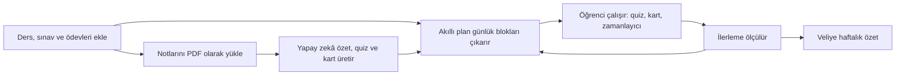

# StudyFlow — İş Gereksinimleri Dokümanı (BRD)

| Alan | Değer |
|---|---|
| Doküman | 01 · İş Gereksinimleri Dokümanı |
| Sürüm | 0.1 (taslak) |
| Tarih | 3 Kasım 2026 |
| Hazırlayan | İş Analisti |
| Durum | İnceleme bekliyor |
| İlgili dokümanlar | [PLAN.md](../PLAN.md) · [02_nfr.md](02_nfr.md) · [Backlog](../agile/backlog.md) · [Proje planı](../agile/project_plan.md) |

---

## 1. Amaç

Bu doküman StudyFlow mobil uygulamasının iş gereksinimlerini tanımlar: hangi problemi çözdüğünü,
kimin için yapıldığını, ilk sürümde neleri kapsadığını ve hangi kurallara uyması gerektiğini.
Ekip (ürün, tasarım, geliştirme, test) için tek referans kaynağıdır. Teknik kararlar
[PLAN.md](../PLAN.md)'de, fonksiyonel olmayan gereksinimler [02_nfr.md](02_nfr.md)'de yer alır.

## 2. Problem tanımı

### 2.1 Mevcut durum
- Öğrenciler çalışma planını kâğıt ajandada, okul ödev defterinde ya da hiç tutmadan yapıyor.
  Plan yazılı olsa bile sınav tarihi yaklaştıkça güncellenmiyor.
- Ders notları, kitap bölümleri ve test kitapları **pasif** okunuyor. Kendini sınama (aktif hatırlama)
  ve aralıklı tekrar gibi etkisi kanıtlanmış yöntemler, hazırlık zahmetli olduğu için az kullanılıyor.
- Hangi derste geri kalındığı, ancak yazılı veya deneme sınavı sonucu geldiğinde fark ediliyor.
- Veliler çocuğun ne kadar ve neye çalıştığını göremiyor. Takip ya sözlü soru-cevapla ya da
  aşırı kontrolle yapılıyor.
- Piyasadaki uygulamalar ya içerik/test çözme odaklı (kişisel plan yok) ya da genel amaçlı
  yapılacaklar listesi (sınav ve müfredat bilgisi yok).

### 2.2 Çözüm önerisi
StudyFlow; öğrencinin ders programını, sınavlarını ve ödevlerini bir araya getirir, yüklediği
PDF'lerden yapay zekâ ile özet, quiz ve flashcard üretir, yaşına uygun günlük çalışma planını
otomatik çıkarır ve ilerlemesini ölçerek planı günceller. Veli, çocuğun ilerlemesini
gizliliğine saygı duyan bir özetle görür.

## 3. İş hedefleri ve başarı ölçütleri

| ID | Hedef | Ölçüt | Hedef değer | Ölçüm zamanı |
|---|---|---|---|---|
| G-01 | Öğrenciler uygulamayı düzenli kullanır | 7. gün geri dönüş (D7 retention) | ≥ %30 | R1 yayınından 8 hafta sonra |
| G-02 | Plan gerçekten uygulanır | Planlanan blokların tamamlanma oranı | ≥ %55 | Haftalık, R1 + 8 hafta |
| G-03 | Öğrenme ölçülebilir şekilde artar | Aynı konudaki quiz doğru oranının 4 haftadaki artışı | ≥ 10 puan | R1 + 12 hafta |
| G-04 | Yapay zekâ özelliği değer üretir | PDF yükleyen aktif kullanıcı oranı | ≥ %40 | R1 + 8 hafta |
| G-05 | Ürün sürdürülebilir | Ücretsizden Pro'ya geçiş oranı | ≥ %3 | R1 + 12 hafta |
| G-06 | Yapay zekâ maliyeti kontrol altında | Aktif kullanıcı başına aylık yapay zekâ maliyeti | ≤ Pro aylık fiyatının %20'si | Aylık |
| G-07 | Kaliteli bir ürün | Çökmesiz oturum oranı / mağaza puanı | ≥ %99,5 / ≥ 4,5 | R1 + 8 hafta |
| G-08 | Portföy değeri | Analiz, tasarım ve teknik dokümanların yayında olması | Tamam | R1 yayını |

> Hedef değerler ilk tahmindir; beta sonuçlarıyla güncellenecektir.

## 4. Paydaşlar

| Paydaş | Rol | Beklentisi | Etki |
|---|---|---|---|
| Ürün sahibi | Vizyon, öncelik, kapsam kararı | Zamanında, ölçülebilir değer üreten ürün | Yüksek |
| İş analisti | Gereksinim, süreç, kabul kriterleri | Net ve izlenebilir gereksinimler | Yüksek |
| Tech lead | Mimari, kod kalitesi, teknik riskler | Sürdürülebilir, güvenli mimari | Yüksek |
| Mobil ve backend geliştiriciler | Geliştirme | Net kabul kriterleri, hazır tasarım | Orta |
| UX/UI tasarımcı | Akışlar, arayüz, yaşa uygun tasarım | Kullanıcı araştırması, tutarlı tasarım dili | Orta |
| QA mühendisi | Test stratejisi ve yürütme | Test edilebilir gereksinimler | Orta |
| Eğitim danışmanı (öğretmen/pedagog) | Müfredat, yaşa uygunluk, çalışma süreleri | Pedagojik olarak doğru kurallar | Orta |
| Hukuk / KVKK danışmanı | Aydınlatma, rıza, çocuk verisi | Mevzuata ve mağaza kurallarına uyum | Yüksek |
| Öğrenciler (ilkokul, ortaokul, lise) | Birincil kullanıcı | Kolay, motive eden, işe yarayan plan | Yüksek |
| Veliler | Onay veren, ödeme yapan, takip eden | Görünürlük, güvenlik, makul ekran süresi | Yüksek |
| Öğretmenler | Dolaylı (R3'te doğrudan) | Öğrencinin düzenli çalışması | Düşük |
| Apple / Google | Platform ve mağaza | Kurallara uyum (çocuk, gizlilik, ödeme) | Yüksek |
| Anthropic (yapay zekâ sağlayıcı) | Claude API | Kullanım politikasına uyum | Orta |
| Altyapı sağlayıcılar (Supabase, RevenueCat, Expo) | Barındırma, ödeme, derleme | Doğru kullanım, ödemeler | Düşük |

## 5. Kullanıcı grupları ve personalar

### 5.1 Segmentler

| Segment | Sınıf | Yaş | Kullanım şekli | Öne çıkan ihtiyaç | İlk sürüm |
|---|---|---|---|---|---|
| İlkokul | 1–4 | 6–10 | Veli yönetiminde | Ödev takibi, kısa ve oyunlaştırılmış çalışma | R2b |
| Ortaokul | 5–8 | 10–14 | Yarı bağımsız | Yazılılar, ödevler, 8. sınıfta LGS | R1 |
| Lise | 9–12 | 14–18 | Bağımsız | Yazılılar, YKS (TYT/AYT), yoğun kaynak | R1 |
| Veli | — | Yetişkin | Onay, ödeme, takip | Görünürlük ve güven | R1 (onay), R2b (panel) |

> **Not:** Ortaokulun 5–7. sınıfları 13 yaş altıdır. Bu yüzden çocuk verisi kuralları (veli onayı,
> mağaza çocuk politikaları) **R1'de zorunludur**; yalnızca ilkokul arayüzü R2b'ye bırakılmıştır.
> Gerekçe ve karar için bkz. [Açık sorular](#17-açık-sorular) Q-01.

### 5.2 Personalar

**Elif, 10 — 4. sınıf (ilkokul).** Ödevlerini unutabiliyor, uzun süre odaklanamıyor. Telefonu
annesinin. Çalışmayı oyun gibi görürse istekli. _İhtiyaç:_ bugün ne yapacağını gösteren basit
bir liste, kısa çalışma blokları, tamamlayınca görsel ödül.

**Can, 13 — 8. sınıf (ortaokul).** LGS'ye hazırlanıyor; okul yazılıları da var. Dershane test
kitaplarıyla boğuluyor, hangi konuya ne zaman döneceğini bilmiyor. _İhtiyaç:_ sınav tarihine
göre kendiliğinden güncellenen plan, zayıf konularının görünmesi.

**Zeynep, 17 — 12. sınıf (lise, sayısal).** YKS'ye 7 ay var. Çok sayıda PDF ve konu özeti
biriktirmiş, okuyor ama aklında kalmıyor. _İhtiyaç:_ notlarından hızlıca soru ve kart üretmek,
tekrarların zamanını uygulamaya bırakmak, çalışma süresini ölçmek.

**Ayşe, 38 — Elif ve Can'ın annesi (veli).** Çocuklarının ne kadar çalıştığını merak ediyor ama
sürekli soru sormaktan kaçınıyor. Uygulamanın verilerini nereye gönderdiği konusunda temkinli.
_İhtiyaç:_ haftalık kısa özet, açık ve anlaşılır izin ekranları, ödeme ve limitlerin kontrolü.

## 6. Kapsam

### 6.1 Sürümler

| Sürüm | Platform | Segment | Hedef tarih | Öz |
|---|---|---|---|---|
| **R1 — MVP** | iOS | Ortaokul + lise (+ veli onayı) | Mart 2027 sonu | Plan, ders/sınav/ödev, PDF → özet/quiz/kart, tekrar, takip, abonelik |
| **R2a — Android** | Android | Ortaokul + lise | Mayıs 2027 | R1'in Android sürümü, deneme sınavı takibi |
| **R2b — İlkokul ve veli** | iOS + Android | İlkokul + veli paneli | Eylül 2027 (okul açılışı) | Veli yönetimli çocuk profili, sade arayüz, veli paneli, aile paketi |
| **R3** | iOS + Android | Tümü + öğretmen | 2027–28 dönemi | Öğretmen/sınıf, yapay zekâ ile sohbet, takvim senkronu, widget |

### 6.2 R1 kapsamına dahil
1. Hesap: e-posta, Apple ve Google ile giriş; sınıf seviyesi seçimi; doğum yılı; hesap silme.
2. Veli onayı: 18 yaş altı için veliye e-posta ile onay bağlantısı; onay kaydı.
3. Dersler: sınıf seviyesine göre hazır ders listesi (MEB), özel ders ekleme, haftalık okul ders programı.
4. Sınavlar ve ödevler: okul yazılıları, LGS/YKS hedef sınavı, ödevler, konu listeleri.
5. Doküman ve yapay zekâ: PDF yükleme, sayfa aralığı seçimi, özet, quiz ve flashcard üretimi, düzenleme, içerik bildirme.
6. Quiz çözme: seviyeye göre şık sayısı, açıklamalı cevaplar, yanlışları tekrar çözme.
7. Flashcard: FSRS ile aralıklı tekrar, elle kart ekleme, internetsiz çalışma.
8. Akıllı plan v1: müsait saatlere, sınav tarihine ve yaşa göre günlük bloklar; kaçırılan blokları yeniden dağıtma.
9. Çalışma takibi: odak zamanlayıcı, oturum kaydı, seri.
10. İlerleme: ders bazında süre, doğru oranı, plan uyumu, haftalık görünüm.
11. Bildirimler: plan hatırlatma, sınav geri sayımı, "quiz'in hazır", sessiz saatler.
12. Abonelik: ücretsiz kota, Pro plan, veli kapısı (parental gate), satın alımı geri yükleme.
13. Yasal: aydınlatma metni, açık rıza, gizlilik politikası, kullanım koşulları.

### 6.3 Kapsam dışı (R1)
- İlkokul arayüzü ve veli paneli (R2b), Android (R2a), deneme sınavı net takibi (R2a).
- Yapay zekâ ile serbest sohbet (öğretmen modu) — çocuklar için ek moderasyon gerektirir (R3).
- Fotoğraftan not okuma, takvim senkronu, widget, iPad'e özel arayüz (R2+/R3).
- Öğrenciler arası paylaşım, sosyal özellikler, sıralamalar.
- Hazır içerik (soru bankası, konu anlatımı) satışı. StudyFlow kullanıcının kendi materyaliyle çalışır.
- Web uygulaması ve İngilizce arayüz (altyapı hazır, içerik yok).

## 7. Süreç

### 7.1 Mevcut süreç (as-is)
Öğrenci sınav tarihini okulda öğrenir → kâğıda/ajandaya not eder → sınavdan birkaç gün önce
notlarını okur → test kitabından soru çözer (varsa) → sonuç gelince eksiklerini fark eder.
Plan yoktur ya da güncellenmez; tekrar zamanlaması tesadüfidir; veli süreci görmez.

### 7.2 Hedef süreç (to-be)

Döngünün özü: **plan → çalış → ölç → planı güncelle.** Öğrenci kaçırdığı blokları kendisi yeniden
planlamak zorunda kalmaz; zayıf konular plana otomatik olarak daha sık girer.

### 7.3 Ana kullanıcı yolculuğu (R1, lise öğrencisi)
1. Uygulamayı indirir, Apple ile giriş yapar, sınıfını (12) ve doğum yılını seçer.
2. 18 yaş altı olduğu için velinin e-postasını girer; veli onaylayana kadar yapay zekâ ve ödeme kapalıdır, diğer özellikler açıktır.
3. Hazır ders listesinden derslerini işaretler, okul ders programını ve müsait saatlerini girer.
4. Hedef sınav olarak YKS'yi, yaklaşan bir okul yazılısını ve konularını ekler.
5. Fizik notunu PDF olarak yükler; birkaç dakika sonra "Quiz'in hazır" bildirimi gelir.
6. Bugün ekranında 4 blokluk planını görür; quiz çözer, kart tekrarı yapar, zamanlayıcıyla çalışır.
7. Bir günü kaçırır; plan kaçan blokları sonraki üç güne dağıtır.
8. Hafta sonunda İlerleme ekranında ders bazında süresini ve doğru oranını görür.

## 8. Fonksiyonel gereksinimler

**Öncelik (MoSCoW):** Must = sürüm için zorunlu · Should = önemli, ertelenebilir ·
Could = zaman kalırsa · Won't = bu dönem yapılmayacak. **Sürüm:** bkz. §6.1.
Her gereksinim [backlog](../agile/backlog.md)'daki kullanıcı hikâyelerine izlenir.

### 8.1 Hesap ve profil (ACC)
| ID | Gereksinim | Öncelik | Sürüm |
|---|---|---|---|
| FR-ACC-01 | Kullanıcı e-posta ve şifre ile kayıt olur ve giriş yapar; e-posta adresi doğrulanır. | Must | R1 |
| FR-ACC-02 | Kullanıcı Apple ile giriş yapabilir. | Must | R1 |
| FR-ACC-03 | Kullanıcı Google ile giriş yapabilir. | Should | R1 |
| FR-ACC-04 | İlk açılışta sınıf seviyesi (1–12), doğum yılı ve hedef sınav (varsa) alınır. | Must | R1 |
| FR-ACC-05 | Kullanıcı rumuzunu, sınıfını, uyku saatlerini ve günlük çalışma hedefini düzenleyebilir. | Must | R1 |
| FR-ACC-06 | Kullanıcı hesabını uygulama içinden silebilir; silme BR-18'e göre yapılır. | Must | R1 |
| FR-ACC-07 | Kullanıcı kişisel verilerinin bir kopyasını talep edebilir (KVKK başvuru hakkı). | Should | R1 |
| FR-ACC-08 | Yeni eğitim yılında sınıf seviyesini güncellemesi önerilir. | Could | R2a |
| FR-ACC-09 | Veli, kendi hesabı altında çocuk profili oluşturur ve yönetir (ilkokul). | Must | R2b |

### 8.2 Veli onayı ve rıza (CON)
| ID | Gereksinim | Öncelik | Sürüm |
|---|---|---|---|
| FR-CON-01 | Kayıtta doğum yılına göre yaş hesaplanır; 18 yaş altı kullanıcıdan veli e-postası istenir. | Must | R1 |
| FR-CON-02 | Veliye onay bağlantısı gönderilir; veli aydınlatma metnini okur ve açık rıza verir. | Must | R1 |
| FR-CON-03 | Onay beklenirken hesap kısıtlı modda çalışır (BR-02, BR-03); kullanıcı veliye bağlantıyı yeniden gönderebilir. | Must | R1 |
| FR-CON-04 | Rıza kayıtları (kim, ne zaman, hangi metin sürümü) saklanır; veli rızasını geri alabilir. | Must | R1 |
| FR-CON-05 | Yapay zekâ ilk kez kullanılırken neyin gönderilip neyin gönderilmediği anlatılır ve onay alınır. | Must | R1 |
| FR-CON-06 | Satın alma, dış bağlantılar ve rıza ayarları veli kapısının (yetişkin doğrulama) arkasındadır. | Must | R1 |
| FR-CON-07 | Aydınlatma metni, gizlilik politikası ve kullanım koşulları uygulama içinden okunabilir. | Must | R1 |

### 8.3 Dersler ve ders programı (CRS)
| ID | Gereksinim | Öncelik | Sürüm |
|---|---|---|---|
| FR-CRS-01 | Sınıf seviyesine göre MEB haftalık ders çizelgesindeki dersler önerilir; öğrenci seçer. | Must | R1 |
| FR-CRS-02 | Öğrenci listede olmayan bir dersi ad ve renk vererek ekleyebilir. | Must | R1 |
| FR-CRS-03 | Öğrenci haftalık okul ders programını (gün, saat aralığı, ders) girer; okul saatleri plana kapalıdır. | Must | R1 |
| FR-CRS-04 | Dershane, kurs, etüt gibi tekrarlayan dış etkinlikler eklenebilir; plana kapalıdır. | Should | R1 |
| FR-CRS-05 | Derse konu listesi eklenebilir; sınıf seviyesine göre konu şablonu önerilir. | Should | R1 |
| FR-CRS-06 | Ders düzenlenebilir, arşivlenebilir ve silinebilir. | Must | R1 |

### 8.4 Sınavlar ve ödevler (EXM)
| ID | Gereksinim | Öncelik | Sürüm |
|---|---|---|---|
| FR-EXM-01 | Okul sınavı eklenir: ders, tarih, saat, tür (yazılı, ortak sınav, kısa sınav, proje), konular. | Must | R1 |
| FR-EXM-02 | Hedef sınav seçilir: LGS (8. sınıf) veya YKS oturumları (11–12. sınıf); resmi tarihler sistemde tanımlıdır. | Must | R1 |
| FR-EXM-03 | Yaklaşan sınavlar geri sayımla Bugün ekranında gösterilir. | Must | R1 |
| FR-EXM-04 | Ödev eklenir: ders, açıklama, teslim tarihi; tamamlandı olarak işaretlenir. | Must | R1 |
| FR-EXM-05 | Sınav sonucu (puan) girilebilir ve ilerleme analizinde kullanılır. | Should | R1 |
| FR-EXM-06 | Deneme sınavı sonucu ders bazında doğru/yanlış/boş olarak girilir; net hesaplanır (BR-13) ve trendi gösterilir. | Must | R2a |
| FR-EXM-07 | Sınav tarihleri e-Okul'dan otomatik alınır. (Resmi entegrasyon yok; yapılmayacak.) | Won't | — |

### 8.5 Doküman ve yapay zekâ (AI)
| ID | Gereksinim | Öncelik | Sürüm |
|---|---|---|---|
| FR-AI-01 | Öğrenci PDF yükler (Dosyalar, iCloud Drive, paylaşım menüsü); limitler BR-14 ve BR-15'tedir. | Must | R1 |
| FR-AI-02 | Sayfa aralığı seçilir ve belge bir derse/konuya bağlanır. | Must | R1 |
| FR-AI-03 | Belge arka planda işlenir; durum (sırada, işleniyor, hazır, hata) görünür; bitince bildirim gelir. | Must | R1 |
| FR-AI-04 | Sınıf seviyesine uygun dilde, başlıklı ve anahtar kavramlı özet üretilir. | Must | R1 |
| FR-AI-05 | Quiz üretilir: soru sayısı seçilir (5/10/20); şık sayısı BR-12'ye uyar; her soruda doğru cevap, açıklama ve kaynak sayfa bulunur. | Must | R1 |
| FR-AI-06 | Flashcard üretilir (ön yüz, arka yüz, kaynak sayfa) ve derse ait desteye eklenir. | Must | R1 |
| FR-AI-07 | Üretilen özet, soru ve kartlar düzenlenebilir ve tek tek silinebilir. | Must | R1 |
| FR-AI-08 | Yapay zekâ içeriği "yanlış" veya "uygunsuz" diye bildirilebilir; öğe gizlenir ve incelemeye düşer. | Must | R1 |
| FR-AI-09 | Kalan kota görünür; kota dolunca Pro planı önerilir. | Must | R1 |
| FR-AI-10 | Taranmış (görüntü) PDF'ler de işlenir. | Should | R1 |
| FR-AI-11 | PDF'ten konu başlıkları çıkarılır ve derse konu olarak eklenmesi önerilir. | Should | R1 |
| FR-AI-12 | Kamera ile çekilen not fotoğrafı işlenir. | Could | R2a |
| FR-AI-13 | Yapay zekâ ile soru-cevap sohbeti (öğretmen modu). | Could | R3 |

### 8.6 Quiz (QZ)
| ID | Gereksinim | Öncelik | Sürüm |
|---|---|---|---|
| FR-QZ-01 | Quiz soru soru çözülür; şık seçilip onaylanınca doğru cevap ve açıklama gösterilir. | Must | R1 |
| FR-QZ-02 | Sonuç ekranında doğru, yanlış, boş sayısı, süre ve konu bazında sonuç gösterilir. | Must | R1 |
| FR-QZ-03 | Yalnızca yanlış ve boş bırakılan sorular yeniden çözülebilir. | Must | R1 |
| FR-QZ-04 | Yanlış cevaplanan sorulardan flashcard oluşturulması önerilir. | Should | R1 |
| FR-QZ-05 | Süreli sınav modu (geri bildirim sonda, LGS/YKS formatı). | Could | R2a |

### 8.7 Flashcard ve tekrar (FC)
| ID | Gereksinim | Öncelik | Sürüm |
|---|---|---|---|
| FR-FC-01 | Kartlar derse bağlı destelerde tutulur; elle kart eklenip düzenlenebilir. | Must | R1 |
| FR-FC-02 | Tekrar FSRS ile yapılır: kart çevrilir, Tekrar/Zor/İyi/Kolay seçilir, sonraki tekrar tarihi hesaplanır. | Must | R1 |
| FR-FC-03 | Bugün tekrar edilecek kart sayısı Bugün ekranında gösterilir. | Must | R1 |
| FR-FC-04 | Tekrar internetsiz yapılabilir; bağlantı gelince sunucuyla eşitlenir. | Must | R1 |
| FR-FC-05 | Günlük yeni kart sınırı sınıf seviyesine göre varsayılan değerle gelir ve değiştirilebilir. | Should | R1 |

### 8.8 Akıllı plan (PL)
| ID | Gereksinim | Öncelik | Sürüm |
|---|---|---|---|
| FR-PL-01 | Öğrenci hafta içi ve hafta sonu müsait saatlerini girer. | Must | R1 |
| FR-PL-02 | Sistem; sınavlar, konular, zorluk, müsaitlik ve BR-07–BR-11'e göre önümüzdeki 14 günün bloklarını üretir. | Must | R1 |
| FR-PL-03 | Blok türleri: konu çalışma, quiz, kart tekrarı, ödev (R2a'da deneme sınavı). | Must | R1 |
| FR-PL-04 | Blok tamamlanır, atlanır ya da ertelenir; kaçırılan bloklar BR-10'a göre yeniden dağıtılır. | Must | R1 |
| FR-PL-05 | Plandaki önemli değişiklikler kısa bir cümleyle açıklanır ("Fizik yazılına 3 gün kaldığı için…"). | Should | R1 |
| FR-PL-06 | Öğrenci bloğu elle ekleyebilir ve başka güne taşıyabilir. | Should | R1 |
| FR-PL-07 | Doğru oranı düşük konular plana daha sık girer. | Should | R1 |
| FR-PL-08 | Haftalık takvim görünümü sunulur. | Must | R1 |

### 8.9 Çalışma takibi (TR)
| ID | Gereksinim | Öncelik | Sürüm |
|---|---|---|---|
| FR-TR-01 | Odak zamanlayıcı blok süresine göre çalışır ve mola hatırlatır. | Must | R1 |
| FR-TR-02 | Çalışma oturumu (ders, konu, süre) kaydedilir; elle oturum eklenebilir. | Must | R1 |
| FR-TR-03 | Seri ve günlük hedef ilerlemesi gösterilir (BR-17). | Must | R1 |
| FR-TR-04 | Rozetler ve oyunlaştırma öğeleri. | Could | R2b |

### 8.10 İlerleme ve analiz (AN)
| ID | Gereksinim | Öncelik | Sürüm |
|---|---|---|---|
| FR-AN-01 | Haftalık çalışma süresi ders bazında gösterilir. | Must | R1 |
| FR-AN-02 | Quiz doğru oranı ders ve konu bazında, zaman içindeki değişimiyle gösterilir. | Must | R1 |
| FR-AN-03 | Plan uyumu (tamamlanan / planlanan blok) gösterilir. | Must | R1 |
| FR-AN-04 | Zayıf konular listelenir. | Should | R1 |
| FR-AN-05 | Sınava hazırlık göstergesi (konu kapsamı ve doğru oranı). | Could | R2a |
| FR-AN-06 | Veliye haftalık e-posta özeti gönderilir (R1); veli paneli uygulama içinde sunulur (R2b). | Should / Must | R1 / R2b |

### 8.11 Bildirimler (NT)
| ID | Gereksinim | Öncelik | Sürüm |
|---|---|---|---|
| FR-NT-01 | Plan bloğu başlarken hatırlatma gönderilir. | Must | R1 |
| FR-NT-02 | Sınavlara 7, 3 ve 1 gün kala bildirim gönderilir. | Must | R1 |
| FR-NT-03 | Yapay zekâ işi bitince ya da başarısız olunca bildirim gönderilir. | Must | R1 |
| FR-NT-04 | Ödev tesliminden 1 gün önce hatırlatma gönderilir. | Must | R1 |
| FR-NT-05 | Bildirim tercihleri ayarlanabilir; sessiz saatlere uyulur (BR-16). | Must | R1 |

### 8.12 Abonelik (SUB)
| ID | Gereksinim | Öncelik | Sürüm |
|---|---|---|---|
| FR-SUB-01 | Ücretsiz plan ile Pro plan karşılaştırması gösterilir. | Must | R1 |
| FR-SUB-02 | Aylık ve yıllık Pro abonelik mağaza ödeme sistemiyle alınır; 18 yaş altında veli kapısı zorunludur. | Must | R1 |
| FR-SUB-03 | Satın alımlar geri yüklenebilir; abonelik durumu cihazlar arasında eşitlenir. | Must | R1 |
| FR-SUB-04 | Aile paketi: tek abonelikle birden fazla çocuk profili. | Should | R2b |
| FR-SUB-05 | 7 günlük ücretsiz deneme. | Could | R1 |

### 8.13 Destek ve yönetim (ADM)
| ID | Gereksinim | Öncelik | Sürüm |
|---|---|---|---|
| FR-ADM-01 | Uygulama içinde SSS ve destek formu bulunur. | Must | R1 |
| FR-ADM-02 | Ekip, bildirilen yapay zekâ içeriklerini bir iç ekrandan inceler ve karara bağlar. | Must | R1 |
| FR-ADM-03 | Kullanıcı başına yapay zekâ kullanımı ve maliyeti raporlanır (iç kullanım). | Must | R1 |
| FR-ADM-04 | Özellikler uzaktan açılıp kapatılabilir; zorunlu güncelleme uyarısı gösterilebilir. | Should | R1 |
| FR-ADM-05 | Resmi sınav tarihleri (LGS, YKS) ekip tarafından yönetilir. | Must | R1 |

## 9. İş kuralları

> Süre, sınır ve yaş eşikleri **varsayılan** değerlerdir. Pedagojik değerler eğitim danışmanıyla,
> yasal eşikler hukuk danışmanıyla teyit edilecektir (bkz. §17).

| ID | Kural |
|---|---|
| BR-01 | Segment sınıf seviyesinden belirlenir: 1–4 ilkokul, 5–8 ortaokul, 9–12 lise. Kurallar segmente göre uygulanır. |
| BR-02 | 13 yaş altındaki kullanıcı, veli onayı gelene kadar yalnızca karşılama ve onay ekranlarını görür; veri girişi yapamaz. |
| BR-03 | 13–17 yaş kullanıcı, veli onayı gelene kadar ders, plan ve kart özelliklerini kullanır; yapay zekâ ve satın alma kapalıdır. |
| BR-04 | Onay bağlantısı 7 gün geçerlidir. 30 gün içinde onaylanmayan 13 yaş altı hesap ve verileri silinir. |
| BR-05 | Yapay zekâ sağlayıcısına kişisel veri (ad, e-posta, okul, doğum yılı, cihaz bilgisi) gönderilmez; yalnızca belge içeriği, sınıf seviyesi ve ders adı gönderilir. |
| BR-06 | Yapay zekâ ile üretilen her içerik "Yapay zekâ ile üretildi, hata içerebilir" etiketi taşır. |
| BR-07 | Varsayılan blok süreleri: ilkokul 15 dk çalışma + 5 dk mola; ortaokul 25 + 5; lise 40 + 10. Kullanıcı segment aralığında değiştirebilir (ilkokul 10–20, ortaokul 20–40, lise 25–60 dk). |
| BR-08 | Plana konan günlük toplam çalışma üst sınırı (okul dışı): ilkokul 60 dk, ortaokul 150 dk, lise 300 dk (hafta sonu +%25). Veli bu sınırı düşürebilir; yükseltemez. |
| BR-09 | Plan; okul saatlerine, dış etkinliklere ve uyku saatlerine blok koymaz. Varsayılan yatış saatleri: ilkokul 21:00, ortaokul 22:00, lise 23:30. |
| BR-10 | Kaçırılan blok, günlük üst sınırı aşmadan sonraki 3 güne dağıtılır. Sığmazsa öğrenciye "planı güncelle" uyarısı gösterilir; blok silinmez. |
| BR-11 | Konu önceliği: sınava kalan gün (≤ 7 gün en yüksek), konu zorluğu ve son doğru oranı ile hesaplanır. Sınav gününe blok konmaz; sınavdan önceki gün yalnızca tekrar blokları konur. |
| BR-12 | Quiz şık sayısı: ilkokul 3, ortaokul 4 (LGS biçimi), lise 5 (YKS biçimi). Her soruda tam bir doğru şık bulunur. |
| BR-13 | Deneme neti: LGS'de net = doğru − yanlış ÷ 3; YKS'de net = doğru − yanlış ÷ 4. Boşlar nete etki etmez. |
| BR-14 | Kota: ücretsiz planda ayda 3 belge, belge başına en çok 20 sayfa; Pro planda ayda 40 belge, belge başına en çok 100 sayfa. Kota her ayın 1'inde yenilenir; başarısız işler kotadan düşülmez. |
| BR-15 | Belge sınırı: yalnızca PDF, en çok 25 MB. Şifreli PDF reddedilir ve nedeni gösterilir. |
| BR-16 | Sessiz saatler: 13 yaş altında 20:30–08:00, diğerlerinde 23:00–07:30 arasında bildirim gönderilmez. Sınav günü sabah bildirimi 07:30'dan önce gönderilmez. |
| BR-17 | Seri için gün sayılması: en az bir plan bloğunun tamamlanması **veya** en az 10 dakika kayıtlı çalışma. Hafta başına 1 "dondurma" hakkı vardır. |
| BR-18 | Hesap silinince belgeler depodan hemen, diğer kişisel veriler en geç 30 gün içinde silinir. Rıza kayıtları ve ödeme kayıtları yasal süre boyunca saklanır. Anonim istatistikler kalabilir. |
| BR-19 | 18 yaş altında satın alma ekranına geçiş veli kapısı ister; mağazanın kendi aile onayı (Ask to Buy) ayrıca geçerlidir. |
| BR-20 | Yüklenen belgeler ve üretilen içerik yalnızca yükleyen kullanıcıya (ve R2b'de bağlı veliye özet olarak) görünür. Paylaşım yoktur. |
| BR-21 | Yapay zekâ içeriği Türkçe ve sınıf seviyesine uygun kelime düzeyinde üretilir; belge dışı bilgi eklenmez, kaynak sayfa belirtilir. |
| BR-22 | FSRS hedef hatırlama oranı %90'dır. Günlük yeni kart sınırı: ilkokul 10, ortaokul 20, lise 30. |
| BR-23 | Bir sorunun bildirimi, o soruyu bildiren kullanıcıdan hemen gizler. Aynı belgede 3'ten fazla bildirim olursa belge incelemeye alınır. |
| BR-24 | Veli, R1'de yalnızca onay ve haftalık özet alır; belge içeriğini, quiz cevaplarını ve oturum ayrıntılarını görmez. |
| BR-25 | 12 ay boyunca giriş yapılmayan hesaba uyarı e-postası gönderilir; 30 gün içinde giriş olmazsa hesap silinir. |

## 10. Veri gereksinimleri

### 10.1 Ana varlıklar
Teknik veri modeli [PLAN.md §4](../PLAN.md#4-veri-modeli-taslak)'te yer alır. İş açısından ana varlıklar:

| Varlık | İçerik | Veri sınıfı |
|---|---|---|
| Kullanıcı / profil | Rumuz, e-posta, doğum yılı, sınıf, segment, tercihler | Kişisel veri (çocuk verisi olabilir) |
| Veli ve rıza kaydı | Veli e-postası, onay zamanı, metin sürümü, IP | Kişisel veri, yasal kayıt |
| Ders, ders programı, etkinlik | Ders adı, renk, gün-saat | Kişisel veri (düşük hassasiyet) |
| Sınav, ödev, konu | Tarih, tür, konu, sonuç | Kişisel veri (eğitim) |
| Belge | PDF dosyası, sayfa sayısı, işlenme durumu | Kullanıcı içeriği (telif sahibi üçüncü kişi olabilir) |
| Özet, quiz, kart | Üretilen içerik, kaynak sayfa | Kullanıcı içeriği |
| Tekrar ve quiz denemeleri | Cevaplar, FSRS durumu, doğru oranı | Kişisel veri (eğitim performansı) |
| Çalışma oturumu, plan bloğu | Süre, ders, durum | Kişisel veri (eğitim) |
| Abonelik | Plan, durum, mağaza işlem kimliği | Kişisel veri, finansal kayıt |
| Yapay zekâ kullanımı | Token, maliyet, süre (içerik değil) | Operasyonel veri |

### 10.2 Veri ilkeleri
- **Veri en aza indirme:** ad-soyad, okul adı, telefon, konum istenmez. Doğum günü yerine doğum yılı alınır.
- **Amaçla sınırlılık:** performans verisi yalnızca plan ve ilerleme için kullanılır; reklam veya profil satışı yoktur.
- **Saklama:** BR-18 ve BR-25. Belgeler işlendikten sonra da kullanıcının erişimi için saklanır; kullanıcı belgeyi ayrıca silebilir.
- **Veri konumu:** Barındırma bölgesi AB (Supabase AB bölgesi). Yurt dışına aktarım KVKK'ya göre değerlendirilir (bkz. Q-03).

## 11. Dış sistemler ve entegrasyonlar

| Sistem | Amaç | Yön | Not |
|---|---|---|---|
| Sign in with Apple, Google Sign-In | Kimlik doğrulama | Uygulama → sağlayıcı | Supabase Auth üzerinden |
| Supabase (Auth, Postgres, Storage, Edge Functions) | Backend | Çift yönlü | AB bölgesi |
| Anthropic Claude API | Özet, quiz, kart, konu çıkarma, plan açıklaması | Edge Function → API | Kişisel veri gönderilmez (BR-05) |
| App Store / Google Play faturalandırma (RevenueCat ile) | Abonelik | Çift yönlü | Sunucu bildirimleriyle durum eşitleme |
| APNs / FCM (Expo Push ile) | Bildirim | Sunucu → cihaz | — |
| İşlem e-postası servisi | Veli onayı, haftalık özet, doğrulama | Sunucu → e-posta | Sağlayıcı seçimi açık (Q-06) |
| Hata ve kullanım izleme | Çökme, performans, ürün analitiği | Uygulama → servis | Çocuk politikaları nedeniyle kişisel veri ve cihaz kimliği gönderilmez (Q-04 → [ADR-006](adr/ADR-006-birinci-taraf-telemetri.md): kendi Supabase'imiz, üçüncü taraf SDK yok) |

## 12. Yasal ve platform gereksinimleri

| Konu | Gereksinim | Kaynak |
|---|---|---|
| KVKK | Aydınlatma metni, açık rıza, veri sorumlusu bilgileri, başvuru kanalı, VERBİS değerlendirmesi | 6698 sayılı Kanun |
| Çocuk verisi | 18 yaş altı için veli rızası, veri en aza indirme, çocuğa anlaşılır dil | KVKK + platform kuralları |
| Apple | Yaş derecelendirmesi; 13 yaş altını hedefleyen uygulamada Kids kuralları (veli kapısı, üçüncü taraf analitik/reklam sınırları); hesap silme; Apple ile giriş; üçüncü taraf yapay zekâya veri paylaşımında açık bilgilendirme ve izin; abonelikte uygulama içi satın alma | App Store İnceleme Yönergeleri |
| Google | Hedef kitlede 13 yaş altı seçildiği için Aile Politikası; Veri güvenliği formu; hesap silme; kişisel hesapta 14 günlük kapalı test | Google Play Politikaları |
| Yapay zekâ sağlayıcı | Reşit olmayanların kullandığı ürünler için ek güvenlik önlemleri (yaşa uygun içerik, filtreleme, izleme, bildirim kanalı) | Anthropic kullanım politikası |
| Telif | Kullanıcı yalnızca kişisel çalışma için yükler; içerik paylaşılmaz; kullanım koşullarında sorumluluk ve bildirim süreci | 5846 sayılı FSEK, kullanım koşulları |
| Tüketici | Abonelik fiyatı, yenileme ve iptal bilgisi açıkça gösterilir | Mağaza kuralları, 6502 sayılı Kanun |

> Ayrıntılı ölçülebilir karşılıklar [02_nfr.md](02_nfr.md) §6 ve §13'tedir. Bu tablo hukuki görüş değildir; hukuk danışmanı teyidi gerekir.

## 13. Varsayımlar

| ID | Varsayım |
|---|---|
| A-01 | Ortaokul ve lise öğrencilerinin önemli kısmının kendi akıllı telefonu vardır; ilkokulda cihaz velinindir. |
| A-02 | Öğrenciler çalışma materyallerinin bir kısmına PDF olarak sahiptir (okul paylaşımları, e-kitap, taranmış not). |
| A-03 | Velilerin büyük kısmı e-posta ile onay vermeyi kabul eder; onay oranı ≥ %70 olur. |
| A-04 | Claude Haiku/Sonnet sınıfı modeller sınıf seviyesine uygun Türkçe soru üretiminde yeterli kaliteye ulaşır (beta öncesi değerlendirme ile doğrulanacak). |
| A-05 | Ekip §4'te ve [proje planında](../agile/project_plan.md) tanımlanan kadroyla çalışır. |
| A-06 | Apple Developer hesabı ürün sahibinde mevcuttur; Google Play hesabı R2a öncesi açılır. |

## 14. Kısıtlar
- **Bütçe:** Küçük ekip ve sınırlı altyapı bütçesi; yapay zekâ maliyeti kullanıcı başına sınırlanmalı (G-06).
- **Zaman:** R1, LGS ve YKS'ye en az 2,5 ay kala (Mart 2027 sonu) yayında olmalı.
- **Platform:** iOS önce; Android, Play hesabı ve 14 günlük kapalı test süresi nedeniyle R2a'ya kaldı.
- **Teknoloji:** Expo (React Native) ve Supabase kararları alınmıştır (PLAN.md).
- **Yasal:** Çocuk verisi kuralları tasarımı ve analitik seçimini kısıtlar.

## 15. Bağımlılıklar
- Hukuk danışmanının aydınlatma metni, rıza metni ve kullanım koşullarını onaylaması (R1 yayını için engelleyici).
- Eğitim danışmanının ders listeleri, blok süreleri ve günlük üst sınırları onaylaması.
- MEB haftalık ders çizelgeleri ve resmi LGS/YKS tarihlerinin açıklanması.
- Apple inceleme süreci; Google Play kapalı test süresi.

## 16. Riskler (özet)
Ayrıntılı risk kaydı ve sahipleri [proje planı §13](../agile/project_plan.md)'tedir.

| ID | Risk | Etki | Önlem |
|---|---|---|---|
| R-01 | Çocuk verisi nedeniyle mağaza reddi | Yüksek | Erken uyum kontrol listesi, veli kapısı, kişisel veri göndermeyen analitik |
| R-02 | Yapay zekânın yanlış veya yaşa uygun olmayan içerik üretmesi | Yüksek | Değerlendirme seti, çıktı denetimi, bildirim akışı, kaynak sayfa |
| R-03 | Yapay zekâ maliyetinin gelirden hızlı artması | Orta | Kota, model seçimi, önbellek, maliyet alarmı |
| R-04 | Veli onay oranının düşük olması | Orta | Onaysız kısıtlı mod, hatırlatma, anlaşılır metin |
| R-05 | Planın gerçekçi olmaması ve kullanıcının bırakması | Yüksek | Yaşa göre üst sınırlar, kolay erteleme, beta ile ayar |

## 17. Açık sorular

| ID | Soru | Sahip | Gereken tarih |
|---|---|---|---|
| Q-01 | İlkokul R2b'ye ertelensin mi? (Öneri: evet. Gerekçe: veli yönetimli ayrı arayüz ve okuma düzeyi gerektiriyor; çocuk verisi kuralları zaten R1'de karşılanıyor.) | Ürün sahibi | Sprint 0 sonu |
| Q-02 | Veli onayı hangi yaş aralığı için zorunlu? (Taslak: 18 yaş altı tümü; 13–17'de kısıtlı mod.) | Hukuk danışmanı | Sprint 0 sonu |
| Q-03 | Verilerin AB bölgesinde barındırılması ve yapay zekâ sağlayıcıya aktarım için hangi KVKK mekanizması kullanılacak? | Hukuk danışmanı | Sprint 1 |
| Q-04 | Hangi hata/analitik araçları çocuk politikalarıyla uyumlu? (Kişisel veri ve cihaz kimliği göndermeyen yapılandırma şart.) **Kapandı:** [ADR-006](adr/ADR-006-birinci-taraf-telemetri.md) | Tech lead | Sprint 1 |
| Q-05 | Pro fiyatı ve ücretsiz kota (BR-14) nasıl olacak? | Ürün sahibi | Sprint 3 |
| Q-06 | İşlem e-postası sağlayıcısı hangisi? | Tech lead | Sprint 1 |
| Q-07 | Uygulama App Store'da "Kids" kategorisinde mi yer alacak, yoksa genel Eğitim kategorisinde yaş derecelendirmesiyle mi? | Ürün sahibi + hukuk | Sprint 0 sonu |
| Q-08 | "StudyFlow" adı App Store ve marka tescilinde müsait mi? | Ürün sahibi | Sprint 0 |

## 18. Sözlük

| Terim | Açıklama |
|---|---|
| MEB | Millî Eğitim Bakanlığı. Ders çizelgelerini ve müfredatı belirler. |
| Yazılı / ortak sınav | Okulda yapılan dönem sınavları. Bazı derslerde il/ülke genelinde ortak yapılır. |
| LGS | Liselere Geçiş Sistemi sınavı; 8. sınıf sonunda yapılır, sorular 4 şıklıdır. |
| YKS (TYT, AYT, YDT) | Yükseköğretim Kurumları Sınavı ve oturumları; sorular 5 şıklıdır. |
| Deneme sınavı | LGS/YKS formatında yapılan prova sınav. |
| Net | Doğru sayısından yanlışların belirli oranının düşülmesiyle bulunan puan (BR-13). |
| Optik form | Sınavlarda cevapların baloncuk işaretlenerek verildiği form. |
| KVKK | 6698 sayılı Kişisel Verilerin Korunması Kanunu. |
| Aydınlatma metni / açık rıza | Veri işleme hakkında bilgilendirme / belirli bir işleme için özgür iradeyle verilen onay. |
| Veli kapısı (parental gate) | Çocuğun tek başına geçemeyeceği yetişkin doğrulama adımı. |
| FSRS | Free Spaced Repetition Scheduler; kartların ne zaman tekrar edileceğini hesaplayan algoritma. |
| Blok | Plandaki tek bir çalışma birimi (ör. 40 dk Fizik konu çalışma). |
| Segment | Kullanıcı grubu: ilkokul, ortaokul, lise, veli. |

## 19. Onay

| Rol | Ad | Tarih | Karar |
|---|---|---|---|
| Ürün sahibi | | | |
| Tech lead | | | |
| Hukuk danışmanı (§12, BR-02–BR-05, BR-18) | | | |
| Eğitim danışmanı (BR-07–BR-12, BR-22) | | | |
